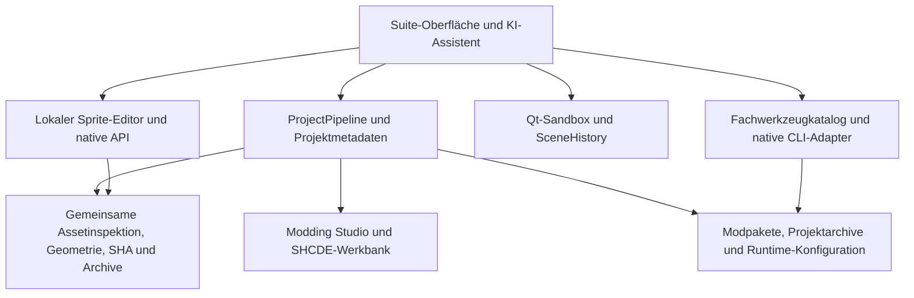

# SpriteSuite – Konsolidierung und Release vom 8. November 2026

**Fortsetzung auf `main`:** RC4 wurde nach `main` zusammengeführt; anschließend wurden die gemeinsamen Tk-Root-/Layoutfehler korrigiert. Der folgende Bericht beschreibt die ursprüngliche Konsolidierung. Für die anschließende Entwicklung mit freiem Atlas-Transfer, PNG/XAML-Arbeitsbereich und Startseiten-Chat gilt der [RC5-Bericht](SPRITESUITE_RC5_20261108.md).

[RC4-Prüfstand mit Ergebnissen und offenen Grenzen](SPRITESUITE_RC4_QA_20261108.md).

## Kanonische Basis und Herkunft

Der Integrationszweig `integration/spritesuite-release-consolidation-20261108` baut auf dem veröffentlichten RC3-Commit `9e681b9433a2fd379be3ae000f386e0e36d6f318` auf. Das GitHub-Repository wurde in ein neues Arbeitsverzeichnis geklont. Damit bleiben die vollständige veröffentlichte Historie und die Windows-, Unicode-, Renderer- und Exportkorrekturen aus RC3 erhalten.

Die neuen lokalen Wiederherstellungs-Repositories haben eigene Wurzelcommits. Ihre Abstammung wird nicht als gemeinsame Git-Historie ausgegeben: `fe6cb3b` ist inhaltlich identisch mit `d09397d`; die Originalgebäude-Ergänzungen aus `46250d2` entsprechen den einschlägigen Dateien aus `673eb09`. Übernahmen erfolgen anhand dieser Dateiinhalte und der jeweiligen Funktionsänderungen.

## Übernahmematrix

| Entwicklung | Übernahme und Zusammenführung |
|---|---|
| Editor/KI `e6a413d` | Gemeinsamer visueller Geometrie-Inspektor, KI-Werkstatt und Umgebungserkennung. |
| Konvergenz `df2e7f3` | Gemeinsame Bildregistrierung für allgemeine KI und HP/Feuer, Pivot-Messnachweise, Toolchain-Kandidaten und persistenter Generierungsstatus. |
| Uncommitted Unified/EditorAI | Historisches `zinnenlineal.versatz.v1`, Animationen/Richtungsframes, Texturen, Qualitätsdiagnostik, gemeinsame Assetinspektion und Werkzeugintegration. Die Zuordnung von Alternativframes prüft vollständige Namen statt nur Gruppen-/Frameindizes. |
| ToolIntegration `f0dd031` und Unified-Overlay | Statische CLI-Hilfe ohne Ausführung fremder Skripte, DE/EN-Suche, überprüfte Datei-/ZIP-Ausgabe und direkter Save-As-Export. RC3-Pfad-, Manifest-, Unicode- und Atomizitätskorrekturen bleiben erhalten. |
| Runtime `b91e3a7` | Native Gebäudebindungen, bestätigte Renderer-Rücklesungen und strengere zeitliche Zuordnung echter HP-/Brand-/Spriteprotokolle. RC3-Beobachter für mehrere Instanzen und große Grafikflächen bleibt erhalten. |
| SHCDE-Expansion, uncommitted | 16 Fachbereiche für AIV/Lords, Szenarien, Mod-Einstellungen, API-/Native-Quellen, Inspektor/Gameplay-Build und Paketkomposition. Der Projektadapter verknüpft die vorhandenen Dateien des zentralen Suite-Projekts; der gemeinsame verwaltete Builder kompiliert gegen die ausgewählten Spielbibliotheken. |
| Modding Studio v3 `e501348a` | Zwölf Offline-Arbeitsbereiche als Quellmodule, CLI und Suite-Fenster; SDK-Versionsabweichungen sind Diagnosen und sperren Offline-Entwürfe nicht. Der Zustand liegt in den Metadaten des aktiven Suite-Projekts und wird im Projektarchiv gesichert. |
| Separater GeometryAI-Entwurf | Die abweichende 1024er Registrierung und zweite Gruppe von Editoren werden durch den gemeinsamen Editor und dessen Registrierung ersetzt. Verdeckte RGBA-Werte und bestehende Projektformate bleiben erhalten. |
| Legacy-Diplomatie | Die uncommitteten Core-/Feature-Dateien sind bereits bytegleich im kanonischen Bestand vorhanden. Die separate laufende Spiel-/Diplomatieentwicklung wird nicht überschrieben. |

## Gemeinsame Abläufe

### Zeitliche Einordnung

| Stand | Entwicklung und Übernahme |
| --- | --- |
| Bis 30.10.2026 | Projektarchive, HUD-/Noesis-Werkstatt und portable Windows-Basis; im veröffentlichten Verlauf erhalten. |
| 01.–06.11.2026 | Originalgrafik-/Sandbox-Werkzeuge, Anleitung, Workflow-Oberfläche, Toolmatrix und mehrere Runtime-/Renderer-Integrationszweige. Ihr Inhalt wurde gegen RC3 und die jüngeren Wiederherstellungen verglichen. |
| 07.11.2026, RC3 `9e681b9` | Windows-/Tcl-Start, Unicode-/Exportkorrekturen, Runtime- und QA-Quellen; unveränderte veröffentlichte Abstammungsbasis. |
| 08.11.2026, `e6a413d` → `f4d3e0d` | Geometrie, allgemeine KI-Werkstatt, Discovery und gemeinsame Inspektion aus dem zusätzlichen Entwicklungsstand übernommen. |
| 08.11.2026, `df2e7f3` → `0b0ceb7` | Pivot/Messnachweise, gemeinsame KI-Registrierung und Toolchain-Nachweise zusammengeführt. |
| 08.11.2026, abschließende Konsolidierung | Noch uncommittete Tool-/Exportverbesserungen, Studio v3, SHCDE-Werkbank, Runtime-Bindungen, Layoutüberlauf und integrierter Suite-Assistent. Herkunft und Entscheidungen stehen in der Übernahmematrix und den verlinkten Fachberichten. |

### Gemeinsame Architektur

Spezialformate und vorhandene CLI-Einstiege bleiben erhalten. Gemeinsame
Projektdateien und Metadaten verbinden die Arbeitsbereiche. Die Browser- und
Qt-Adapter benutzen die jeweilige bestehende Undo-Historie. Runtime-Quellen und
der gemeinsame verwaltete Builder erzeugen optionale Plugins gegen ausdrücklich
ausgewählte lokale Spiel-/SDK-Bibliotheken.

- **Grafik und KI:** Original auswählen → Geometrie/Pivot/Messdaten prüfen → Variantenauftrag mit Bildreferenz und Prompt → lokale Codex-Sitzung mit ChatGPT-Anmeldung → Rohbild und registrierter Kandidat mit SHA-256 → manuelle Auswahl/Undo → Sprite- oder Schadensexport.
- **Projekt:** Grafik, XAML und eigene Mod-Dateien gemeinsam bearbeiten → Asset-/Maskeninspektion → Paketdateien gegen das Projekt prüfen → Mod-ZIP an gewähltem Ziel speichern → bearbeitbares Projekt einschließlich Modding-Studio-Quellen sichern und wiederherstellen.
- **Modding Studio:** Den Arbeitsbereich aus der Suite öffnen; die zwölf Fachmodule verwenden dieselben Validatoren wie ihre CLI. Missionen, AIV, Balancing, Audio, Lua/C#-Quellen, SDK- und Native-Nachweise bleiben als Offline-Entwürfe bearbeitbar.
- **Gebäudeschäden:** Freie eigene Grafikzuordnungen werden von der optionalen Ingame-Beweisprüfung getrennt. Ein Kompilierungserfolg oder ein synthetischer Selbsttest ist keine bestätigte Spieländerung.

Das freie Modpaket bewahrt eigene DLLs, Lua-Skripte und Metadaten unverändert. Ein vorgeschriebener Unterordner, ein künstlicher Freigabestatus oder eine bestimmte SDK-Version ist dafür nicht nötig. Datenstruktur-, Traversal- und Überschreibprüfungen bleiben bestehen. Normale Arbeitsbereichsaktionen benötigen keinen zweiten Bestätigungsdialog.

### End-to-End-Funktionsmatrix

| Ablauf | Praktisch geprüft | Verbleibende Grenze |
| --- | --- | --- |
| Grafik → Bearbeitung → Mod-ZIP → Projektarchiv → Wiederherstellung | Synthetische PNGs, Pixelbytes, freie Moddateien, Metadaten, CRC/SHA und neues Wiederherstellungsziel. | Tatsächliche Darstellung jedes individuellen Pakets im Spiel ist separat zu prüfen. |
| Originalreferenz → KI-Auftrag → Konto → Kandidat → Registrierung | Ein realer ChatGPT-/Codex-Bildauftrag und Browserprüfungen für Kandidaten, Geometrie, Übernahme und Undo. | Visuelle Qualität bleibt eine individuelle Entscheidung; Kontolimits und Clientverfügbarkeit gelten. |
| KI-Assistent → native Projektwerkzeuge → geprüftes Modpaket | Tatsächlicher Konto-Turn mit zehn Werkzeugaufrufen; unabhängige ZIP-/Bildprüfung. | Kein Anspruch auf fehlerfreie Bearbeitung beliebiger Aufgaben. |
| HTML-/Qt-Bearbeitung → bestehendes Modell → Undo/Redo | Native Aktionen und Formulare, Datei-Roundtrips, Szenenoperationen und Zustandswechsel. | Veraltete Zustände, fehlende Dateiauswahl oder noch nicht geöffnete Fenster werden als solche zurückgegeben. |
| Studio/SHCDE → gemeinsames Projekt → Speichern/Sichern/Wiederöffnen | Offline-Arbeitsbereiche, Lifecycle, Dateiverknüpfung und Metadatenübertragung. | Native SDK-/Gameplay-Wirkung erfordert die passende echte Runtime. |
| HP-/Feuerbibliothek → Bindungen → DLL/Konfiguration → Spielrenderer | Export-/Bindungs-/C#- und synthetische Runtimeprüfungen, realer vorhandener HP-Nachweis ausgewertet. | Echter Spritewechsel unter HP/Feuer und Rückkehr zur Originalgrafik sind im Spiel noch nicht abgenommen. |

## ChatGPT-/Codex-Anbindung

Allgemeine KI- und Schadensaufträge verwenden denselben verwalteten lokalen Codex-Client. Die Suite liest keine Kontotokens aus und benötigt keinen API-Schlüssel. Die neue direkte API-Route wurde bei der Integration ersetzt. Ein installierter Codex-Client und die angemeldete ChatGPT-Sitzung sind Voraussetzung; Kontolimits werden vom Dienst bestimmt.

Der echte Ersttest verwendete genau eine eigene synthetische Referenz von 64 × 32 Pixeln. Codex lieferte eine Variante; die gemeinsame Registrierung normalisierte sie aus 1536 × 1024 zurück auf die Originalmaße. Die Eingabe und das Ergebnis wurden mit SHA-256 geprüft. Das ist ein Nachweis des realen Konto-/Generierungsablaufs, keine visuelle Abnahme fremder Spielgrafik.

## Integrierter KI-Assistent und native Bedienung

Der ergänzte KI-Modus arbeitet mit einem lokalen Codex-App-Server und verwalteter ChatGPT-Anmeldung. Die dynamischen Werkzeuge delegieren an die tatsächlichen SpriteSuite-Funktionen: Projektkontext, statischer Werkzeugkatalog, native CLI-Kommandos mit strukturierten Argumenten und Projektoperationen. Der Assistent erhält keine unabhängige Shell- oder Codeauswertung. Werkzeugantworten, Abbruch, Fehler und abgeschlossene Codex-Turns werden unterschieden; wiederholte Aufruf-IDs führen dieselbe Änderung nicht nochmals aus.

Ein echter Konto-Durchlauf erstellte im isolierten Testprojekt ein transparentes 16×16-PNG und ein Modpaket mit GUID `native.assistant.proof`. Die Datei wurde ausschließlich durch die bestehenden Projektmethoden erzeugt. Der unabhängige ZIP-Test bestätigte CRC, PNG-Bytegleichheit sowie GUID, Name, Autor und Version im Manifest. ZIP-SHA-256: `d3dc6c55f3e94dad2dcd1a37763d84c765a180da55716e224f1102a59d72cf43`. Der Agent korrigierte zwei konkrete Aufruffehler und berichtete sie; das Ergebnis ist keine Behauptung allgemeiner Fehlerfreiheit.

Der Assistent ist über die Suite-Navigation und das Werkzeugmenü erreichbar. Er kann das aktive Projekt lesen und bearbeiten, die tatsächlichen Tk-Bedienelemente über stabile IDs bedienen, den lokalen HTML-Editor über dessen native Schnittstelle steuern und die bereits geöffnete Qt-Sandbox bearbeiten. Der Browseradapter übergibt ausdrücklich ausgewählte lokale Dateien an die bestehenden Importfunktionen. Die Qt-Sandbox verwendet die vorhandene Szenenhistorie für Platzieren, Verschieben, Auswahl, Löschen und Undo/Redo. GUI-Aufrufe laufen auf dem GUI-Thread; Browser- und CLI-Arbeit laufen außerhalb der Oberfläche.

Zustandstoken verhindern Änderungen auf Grundlage veralteter Ansichten. Abbruch und begrenzte Werkzeugausgaben sind Teil des Protokolls. Dateidialoge werden als erforderliche Eingabe zurückgemeldet; notwendige Benutzereingaben werden nicht erfunden. Für Spieländerungen und unbekannte Werkzeugwirkungen gilt die vorhandene ausdrückliche Freigabe. Der Assistent verwendet keine unabhängige Shell und liest keine Kontotokens aus. [Native Schnittstellen und Ablauf](SPRITESUITE_NATIVE_ASSISTANT_TOOLS.md).

## Erreichbare Arbeitsflächen

Die native Tk-Anbindung umfasst auch Schreiben im vorhandenen Texteditor,
Listen-/Skalenwerte sowie Pinsel- und Ziehgesten in den bestehenden Pixel-, HUD-
und Origins-Editoren. Die Gesten verwenden deren normale Ereignisse und Undo.
Ein dabei entdeckter falscher BOM-Codecname im Texteditor wurde korrigiert;
der reale Text-/Dirty-/Undo-Weg ist Teil der gezielten Regression.

Die Hauptarbeitsfläche und die Seitennavigation besitzen eigene Scrollbereiche. Das Notebook wird direkt im scrollbaren Viewport erstellt, damit native Tk-Kindfenster auch bei kleiner Höhe richtig gezeichnet werden. Eingabefelder sind in zwei Spalten angeordnet, Aktionsleisten umbrechen und die Vorschau passt sich an den verfügbaren Platz an. Tastaturfokus macht das angesprungene Feld sichtbar. Die Modding-Studio-Fenster sowie Browserleisten, Seitenpanels und Dialoge berücksichtigen schmale und niedrige Fenster ebenfalls.

Die Hauptansicht wurde mit 1020×680 und 1280×720 sowie vergrößerter Windows-Darstellung geprüft; der HTML-Editor zusätzlich bis 640×360. Diese Prüfung umfasst erreichbare untere Metadatenfelder und sichtbare Scrollleisten. Ungewöhnliche Inhalte, zusätzliche Systemschriftgrößen und andere Rechner können weitere Layoutfälle ergeben; die Prüfung ist kein Versprechen allgemeiner Fehlerfreiheit.

## Windows-Auslieferung

Das öffentliche Windows-Startpaket enthält den Projektquellstand und CPython. Die zusätzlichen Python-Pakete werden beim ersten Start aus dem SHA-256-Lock lokal installiert. Ein bereits angefangener, unterbrochener Erststart wird erneut eingerichtet. Separates System-Python ist für dieses Paket nicht erforderlich; für die erste Installation wird Internet benötigt.

Der vollständige Offline-Portable-Kandidat wird gesondert lokal erstellt und geprüft. Seine mitgelieferten Drittanbieter-Binärdateien werden nicht ungeprüft auf GitHub hochgeladen. Das öffentliche Startpaket enthält weder diese Qt-/FMOD-Laufzeiten noch eine Spielinstallation. Die Quellcode-Ausgabe unterstützt weiterhin separat installiertes Python 3.13 oder 3.14.

## Abnahmegrenzen und Bereinigung

Die vorhandene echte HP-/Feuer-Aufzeichnung zeigt HP-Änderungen, jedoch keinen bestätigten Treffer der geprüften Sprite-Zellen. Die Spielabnahme bleibt fehlgeschlagen/offen. Für einen erneuten Durchlauf ist eine funktionierende lizenzierte QA-Spielsitzung nötig. Keine erfolgreiche HP-/Feuer-/Renderer-Freigabe wird behauptet.

Alte Zweige, Worktrees, persönliche Savegames und Spieleinstallationen bleiben erhalten. Die vom Nutzer ausdrücklich an bestandene Abnahme gebundene Bereinigung ist nicht freigegeben. Weder die GitHub-Standardbranch noch bestehende Release-Tags werden umgeschrieben.
